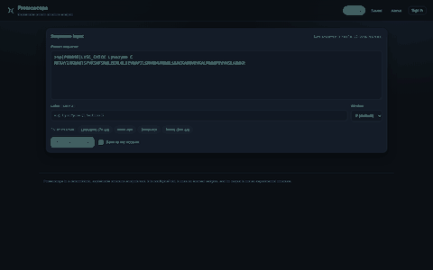
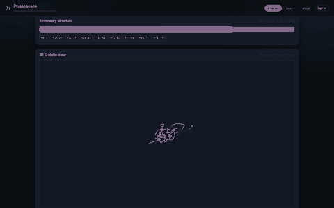
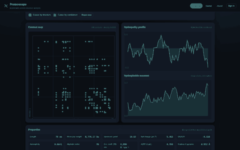
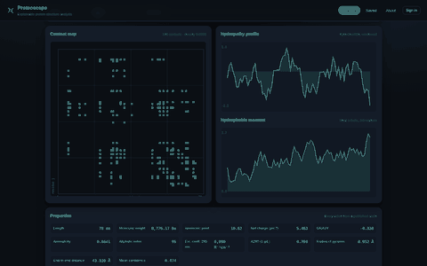
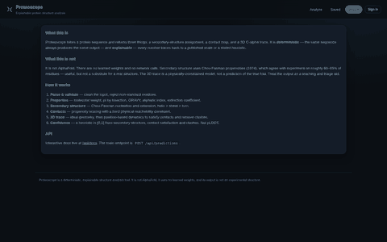
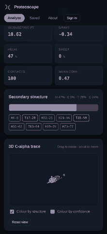

# Proteoscope

**Deterministic, explainable protein structure analysis.** Paste a sequence, get
secondary structure, a contact map, and a 3D C-alpha trace — with every number
traceable to a published scale.

[](https://www.python.org/)
[](https://fastapi.tiangolo.com/)
[](#tests)
[](LICENSE)
[](#what-this-is-not)

---

## What it does

Proteoscope is a protein structure analysis tool that runs entirely in your
browser and on a small FastAPI backend. Paste a protein sequence and get back:

- **Physicochemical properties** — molecular weight, isoelectric point, charge
  at pH 7, GRAVY hydrophobicity, and amino-acid composition.
- **Secondary structure** — a Chou-Fasman prediction with per-residue
  assignments and helix/sheet/turn/coil fractions.
- **A residue-residue contact map** — predicted contacts with a confidence
  score for each one.
- **A 3D C-alpha trace** — a rotatable backbone model built by a
  position-based-dynamics relaxation, coloured by secondary structure.
- **A per-residue confidence profile** and a full residue table.
- **Exports** — PDB, CSV, and a plain-text report.

## What this is not

This is not AlphaFold, and it does not pretend to be. There are **no learned
weights, no GPU, and no network calls**. Every number comes from a published
scale (Chou-Fasman propensities, Kyte-Doolittle hydrophobicity, standard residue
masses) or a stated heuristic. The same input always gives the same output.

That trade is the whole point. A tool where you can point at any residue and say
*why* it was called a helix is useful in a way an opaque model is not.

## Screenshots

| Analyze | 3D trace |
|---|---|
|  |  |

| Contact map | Properties & per-residue table |
|---|---|
|  |  |

| How it works | Mobile |
|---|---|
|  |  |

## Quick start

```bash
git clone https://github.com/mohdabrarbaloch-arch/day-13-proteoscope.git
cd day-13-proteoscope

python3 -m venv .venv && source .venv/bin/activate
pip install -r requirements.txt
cp .env.example .env
uvicorn app.main:app --reload --port 8013
```

Open http://localhost:8013 — no account needed to run a prediction. Sign in only
if you want to save predictions and export them later.

### With Docker

```bash
docker compose up --build
# app on http://localhost:8013, Postgres on 5433
```

## Usage

### In the browser

1. Paste a sequence (plain text or FASTA) into the box.
2. Optionally give it a label and tick **Save** to keep it on your account.
3. Click **Analyze**. The result appears in three views: Structure, Contacts,
   and Properties.
4. Drag to rotate the 3D trace. Export as PDB, CSV, or text from the result
   panel.

### From the API

```bash
# Register (returns a token immediately — no second login round-trip)
curl -X POST http://localhost:8013/api/auth/register \
  -H 'Content-Type: application/json' \
  -d '{"email":"you@example.com","password":"hunter2hunter2","full_name":"You"}'

# Predict and save
curl -X POST http://localhost:8013/api/predictions \
  -H 'Content-Type: application/json' \
  -H 'Authorization: Bearer <token>' \
  -d '{"sequence":"MKTAYIAKQRQISFVKSHFSRQLEERLGLIEVQAPILSRVGDGTQDNLSGAEKAVQVKVKALPDAQFEVVHSLAKWKR","save":true,"label":"Lysozyme"}'

# Export as PDB
curl http://localhost:8013/api/predictions/1/export?fmt=pdb \
  -H 'Authorization: Bearer <token>'
```

## Tests

```bash
pip install -r requirements-dev.txt
pytest -q          # 79 tests
ruff check .       # clean
black --check .    # clean
```

The tests check against published values rather than re-asserting the
implementation — molecular weight per residue, pI sign behaviour, the physical
reachability of every predicted contact, and the fact that the relaxation does
not diverge. Two of them are regression tests for bugs found during
development: the force-integration divergence, and FASTA header letters being
counted as residues.

## Deployment

Proteoscope ships with two deployment paths, both already wired up:

**Docker** — the whole stack, database included:

```bash
docker compose up --build
# app on http://localhost:8013, Postgres on 5432
```

**Vercel** — serverless, for the API and the static UI:

```bash
npm i -g vercel
vercel --prod --yes --token "$VERCEL_TOKEN"
```

`vercel.json` and `api/index.py` are already in the repo, so the deploy is a
single command once a token is present.

> **Status:** this repo has not been deployed to a live URL yet — the build
> environment it was developed in had no `VERCEL_TOKEN`, and I would rather say
> that plainly than paste a link that does not resolve. Everything needed to
> deploy is committed and the production build passes locally. Add a token and
> the command above puts it online in about two minutes.

## Tech stack

| Layer | Choice |
|---|---|
| API | FastAPI 0.115, Pydantic v2 |
| ORM | SQLAlchemy 2.0 (SQLite dev / PostgreSQL prod) |
| Auth | PyJWT HS256 + bcrypt (12 rounds) |
| Frontend | Vanilla JS, no build step, canvas rendering |
| Tests | pytest + httpx |
| Lint | ruff + black |
| Deploy | Docker, or Vercel serverless |

## Project layout

```
app/
  engine/        # the structure pipeline (sequence, secondary, geometry, predict)
  routers/       # FastAPI routers (auth, predictions, health)
  static/        # the SPA (index.html, styles.css, app.js)
  main.py        # app assembly, middleware, error handling
api/index.py     # Vercel serverless entrypoint
scripts/         # screenshot capture + push helpers
tests/           # pytest suite
```

## License

MIT — see [LICENSE](LICENSE).
